# SABER HEAT — Demo de la PWA

Diseño preliminar y **funcional** de la consola de **SABER HEAT**, un monitor personal de riesgo térmico con forma de sable de energía. Esta demo simula el dispositivo, las lecturas, las alertas y el emparejamiento BLE. Funciona sin base de datos en **modo local** y, si configuras **Neon**, persiste todo en PostgreSQL.

[](https://vercel.com/new/clone?repository-url=https://github.com/Anael19-gg/saber-heat-app)

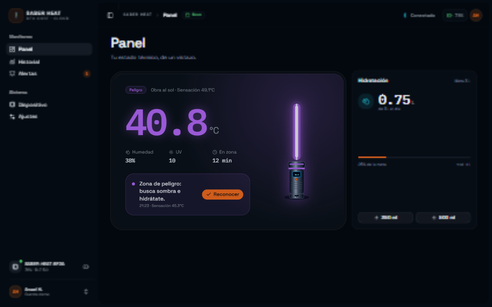

## Qué incluye

- **Panel de control** con temperatura, sensación térmica, humedad, UV, batería y estado de la zona.
- **Simulación en vivo** cada 3.5 s con cuatro escenarios: obra al sol, running, salón y casa.
- **Cálculo del índice de calor** con la fórmula de Rothfusz y umbrales configurables.
- **Sable animado** que cambia de color según la zona: azul, verde, ámbar, rojo y rojo intermitente.
- **Alertas** con reconocimiento, filtros y trazabilidad.
- **Historial** de sesión y resumen de 7 días, con exportación a CSV.
- **Dispositivo** con estado de conexión, batería, señal, sensores, firmware y modo demo.
- **Emparejamiento BLE simulado** en tres pasos, con código de 6 dígitos.
- **Ajustes** de umbrales, unidades (°C/°F), hidratación, notificaciones, sonido, vibración y contacto de emergencia.
- **Persistencia local** de ajustes e hidratación con `localStorage`.
- **Persistencia opcional en Neon** (PostgreSQL): lecturas, alertas, ajustes, hidratación y estado del dispositivo.
- **Sesión firmada** con cookie `HttpOnly` + HMAC-SHA256 y contraseña demo hasheada con scrypt.
- **Modo local automático**: si no hay `DATABASE_URL` o Neon falla, la UI sigue funcionando.
- **Interfaz responsive** con sidebar colapsable, tema oscuro y estética sci-fi.

## Stack

- [Next.js 16](https://nextjs.org/) con App Router y Turbopack
- [React 19](https://react.dev/) + TypeScript
- [Tailwind CSS 4](https://tailwindcss.com/)
- [shadcn/ui](https://ui.shadcn.com/) con Base UI
- [Recharts](https://recharts.org/) para las gráficas
- [Lucide](https://lucide.dev/) para los iconos
- [Sonner](https://sonner.emilkowal.ski/) para los toasts
- [Neon](https://neon.tech/) PostgreSQL serverless + `@neondatabase/serverless`

## Cómo correr

```bash
npm install
npm run dev
```

Abre [http://localhost:3000](http://localhost:3000).

Para compilar:

```bash
npm run build
npm start
```

### Base de datos Neon (opcional)

1. Copia `.env.example` a `.env.local`.
2. Rellena `DATABASE_URL` (pooled) y `DIRECT_URL` (direct) con las cadenas de Neon.
3. Genera los secretos:
   ```bash
   node -e "console.log(require('crypto').randomBytes(32).toString('base64url'))"
   node -e "console.log(require('crypto').randomBytes(16).toString('base64url'))"
   ```
   Usa el primero como `SESSION_SECRET` y el segundo como `HASH_SALT`.
4. Crea el esquema y los datos demo:
   ```bash
   npm run db:seed
   ```
   El seed siembra **24 lecturas y 3 alertas**; volver a ejecutarlo reinicia esas lecturas/alertas del dispositivo demo.
5. Verifica la conexión en [http://localhost:3000/api/health](http://localhost:3000/api/health). Debe responder `{ "ok": true, "db": "neon" }`.

Sin `DATABASE_URL` la app arranca en **modo local** y todo sigue funcionando con `localStorage`.

## Deploy en Vercel

[](https://vercel.com/new/clone?repository-url=https://github.com/Anael19-gg/saber-heat-app)

### Opción A · Dashboard (recomendada)

1. Entra a [vercel.com/new](https://vercel.com/new).
2. Importa el repositorio `Anael19-gg/saber-heat-app`.
3. Vercel detecta **Next.js** automáticamente. Deja los valores por defecto:
   - Framework Preset: **Next.js**
   - Root Directory: **./**
   - Build Command: **next build**
   - Output Directory: **.next**
4. Configura las variables de entorno (opcionales para modo local, necesarias para Neon):
   - `DATABASE_URL` — cadena **pooled** de Neon.
   - `DIRECT_URL` — cadena **directa** de Neon (seed/migraciones).
   - `SESSION_SECRET` — secreto de 32 bytes en base64url.
   - `HASH_SALT` — sal de 16 bytes en base64url.
   - `NEXT_PUBLIC_SITE_URL` — tu dominio final (opcional).
5. Pulsa **Deploy**.

Cada push a `main` despliega producción; cada PR genera un preview automático.

### Opción B · CLI

```bash
npm i -g vercel
vercel login
cd C:\Users\Anael\.t3\projects\ideas\saber-heat-app
vercel
vercel --prod
```

> En Windows, la CLI puede necesitar **Modo desarrollador** para crear los symlinks de su caché. Si aparece `EPERM: operation not permitted, symlink`, usa la opción A (dashboard) o ejecuta la terminal como administrador.

### Variables de entorno

| Variable | Obligatoria | Uso |
| --- | --- | --- |
| `DATABASE_URL` | Para Neon | Cadena **pooled** de Neon usada por las rutas API. Sin ella, modo local. |
| `DIRECT_URL` | Para seed | Cadena **directa** de Neon para `npm run db:seed` y migraciones. |
| `SESSION_SECRET` | Para Neon | Firma la cookie de sesión con HMAC-SHA256. |
| `HASH_SALT` | Para Neon | Sal para el hash scrypt del usuario demo. |
| `NEXT_PUBLIC_SITE_URL` | No | URL canónica para metadata, Open Graph y sitemap. En Vercel se usa `VERCEL_URL` automáticamente si no la defines. |

### Notas de despliegue

- `.nvmrc` fija **Node 22** en Vercel.
- La base de datos es opcional; sin `DATABASE_URL` la app arranca en modo local.
- Si configuras Neon, agrega las variables en **Vercel → Project → Settings → Environment Variables**.
- En Vercel, el esquema se crea en el primer `POST /api/session`. Para tener las 24 lecturas/3 alertas iniciales, corre `npm run db:seed` localmente contra la misma base.
- `poweredByHeader: false` para no exponer la tecnología.
- El proyecto se puede importar desde GitHub o desplegar con la CLI.
- En Windows, la CLI de Vercel puede requerir **Modo desarrollador** para symlinks; el dashboard es la ruta recomendada.

## Neon / Base de datos

La app detecta si existe `DATABASE_URL`. Si está configurada, crea/lee el usuario demo, el dispositivo, las lecturas, las alertas y los ajustes desde PostgreSQL. Si falla o no existe, cae en **modo local** sin romper la UI.

### Esquema

- `app_users`: usuario demo con `password_hash` (scrypt).
- `devices`: dispositivo BLE.
- `readings`: temperatura, humedad, índice, UV, zona y batería.
- `alerts`: eventos y reconocimiento.
- `app_settings`: umbrales, escenario, agua y preferencias.

### API

| Ruta | Método | Uso |
| --- | --- | --- |
| `/api/health` | GET | Prueba `select 1` contra Neon. |
| `/api/session` | POST | Crea/renueva la sesión firmada. |
| `/api/state` | GET | Hidrata el estado del demo. |
| `/api/readings` | POST | Guarda una lectura. |
| `/api/alerts` | POST | Guarda una alerta. |
| `/api/alerts/:id` | PATCH | Reconoce una alerta. |
| `/api/alerts/ack-all` | POST | Reconoce todas. |
| `/api/settings` | PUT | Guarda umbrales y preferencias. |
| `/api/hydration` | POST | Suma agua. |
| `/api/device` | PATCH | Conecta/desconecta. |
| `/api/reset` | POST | Reinicia el demo y vuelve a sembrar 24 lecturas/3 alertas. |

### Seguridad

- Cookie `saber_session` **HttpOnly**, `SameSite=Lax`, `Secure` en Vercel/HTTPS, firmada con **HMAC-SHA256** usando `SESSION_SECRET`.
- Contraseña demo hasheada con **scrypt** y `HASH_SALT`; no se guarda en claro.
- `.env.local` está en `.gitignore`; el repo solo incluye `.env.example`.
- El usuario demo se crea automáticamente; **no hay login real multiusuario** todavía.
- **Importante:** si compartiste la contraseña de Neon en un chat, rótala en el panel de Neon y actualiza `.env.local`/Vercel.

## Capturas

### Neon conectado

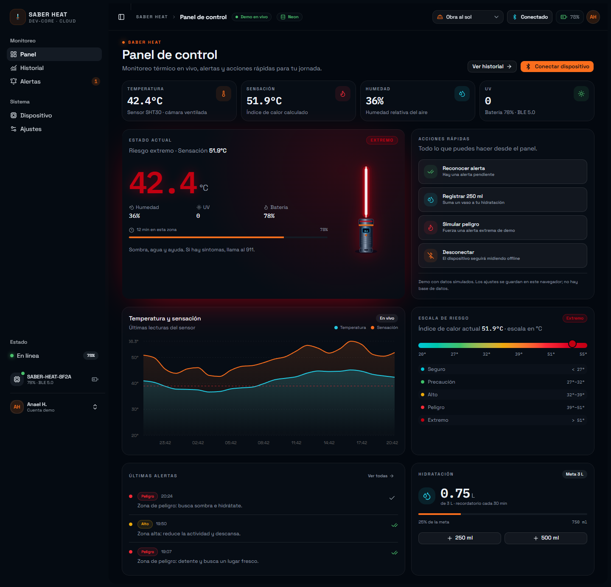

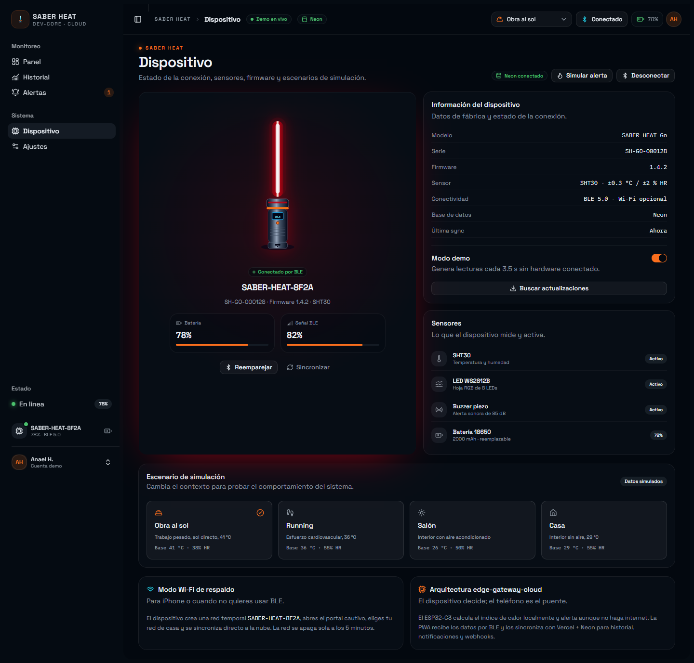

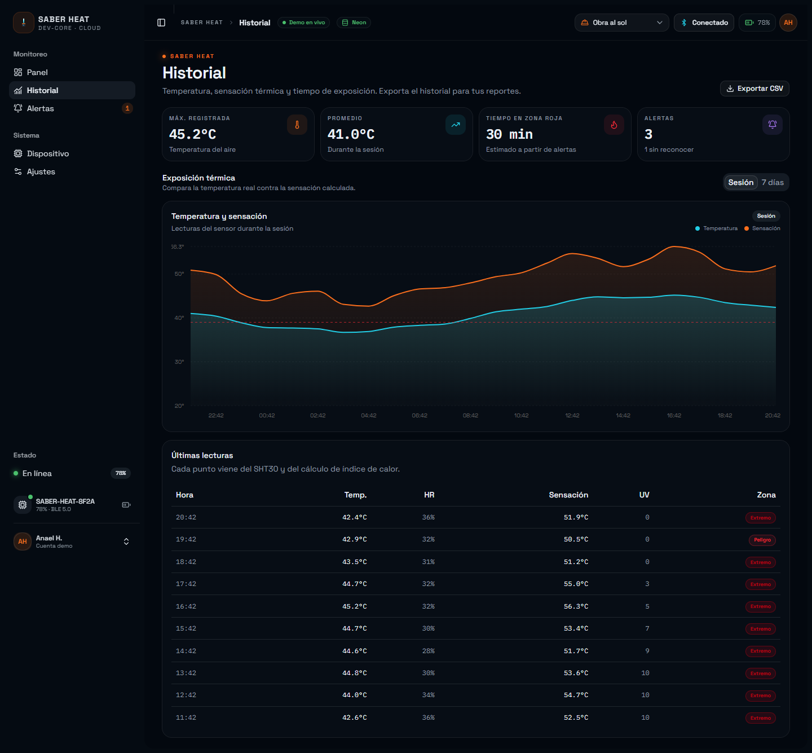

### Dispositivo y emparejamiento

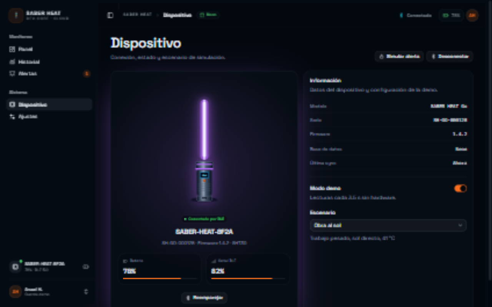

| Paso 1 | Paso 3 | Conectado |
| --- | --- | --- |
| 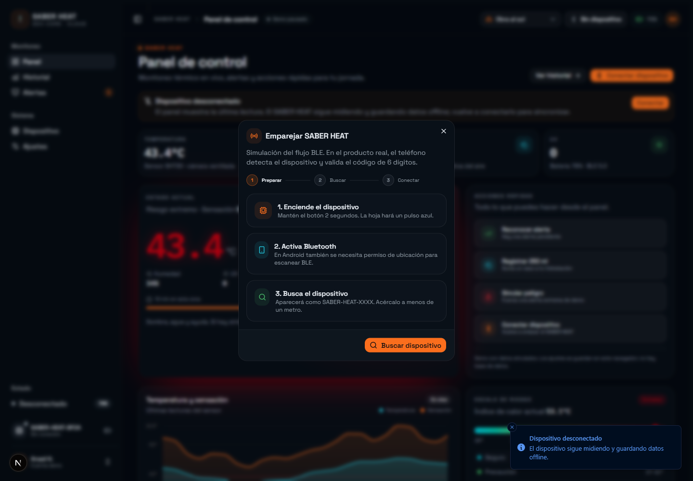 | 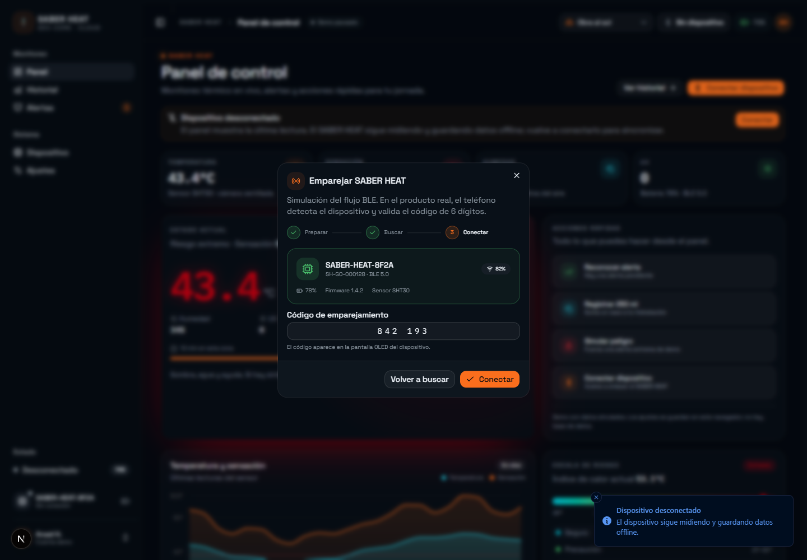 | 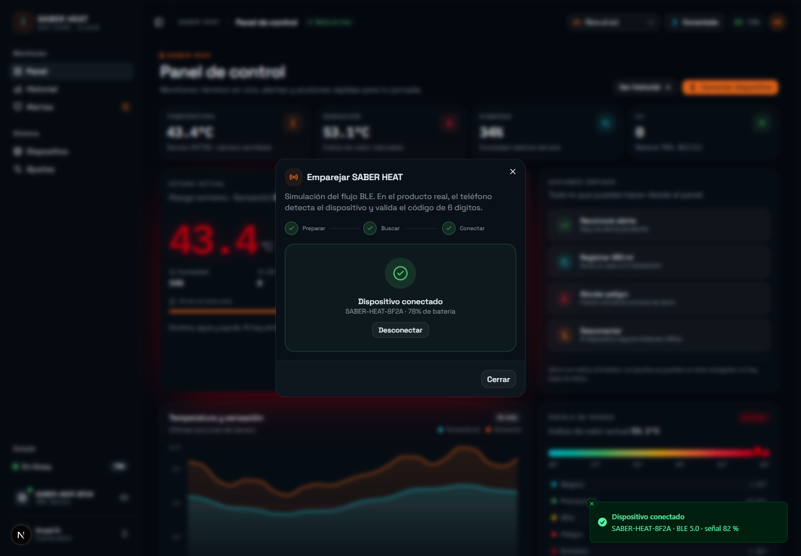 |

### Historial y alertas

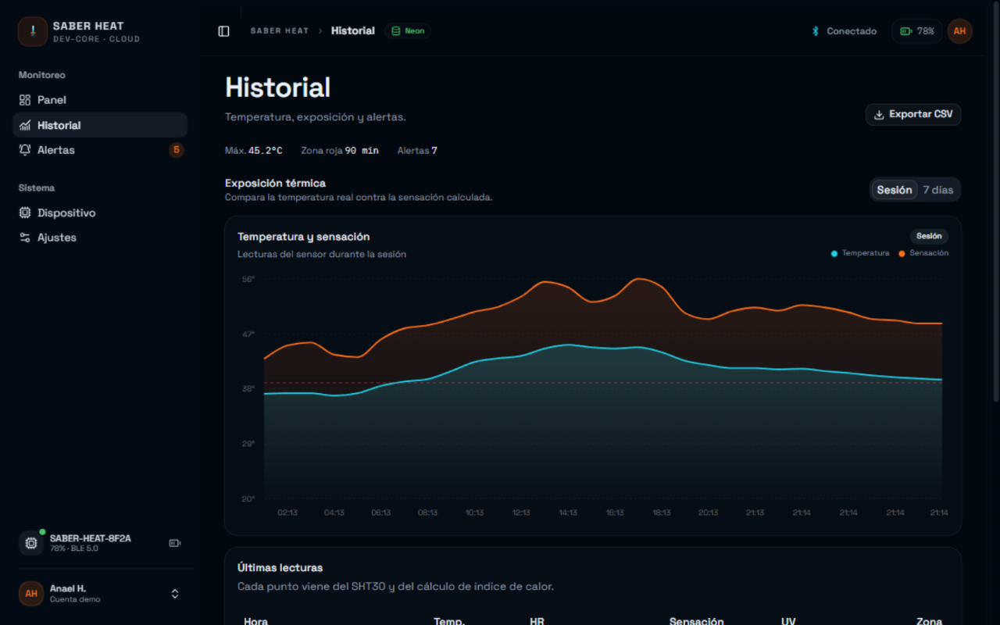

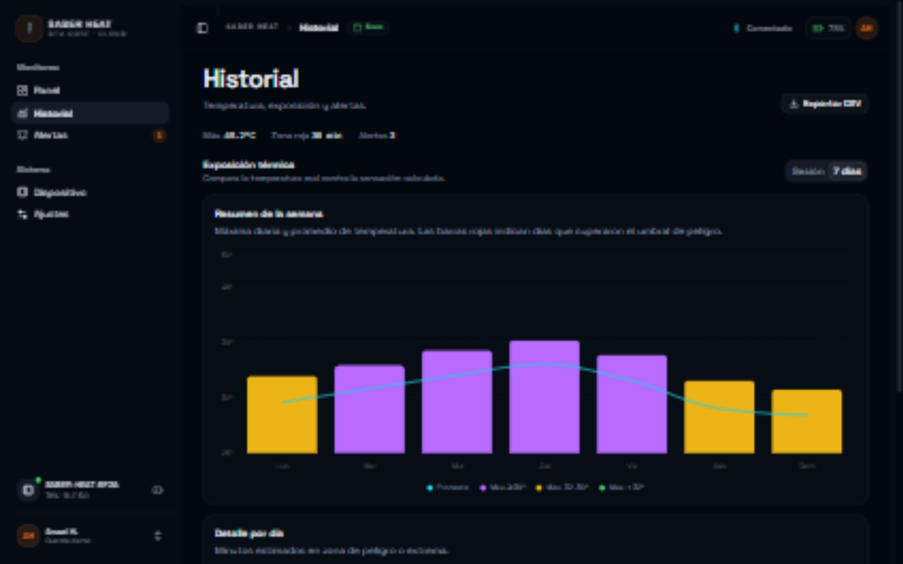

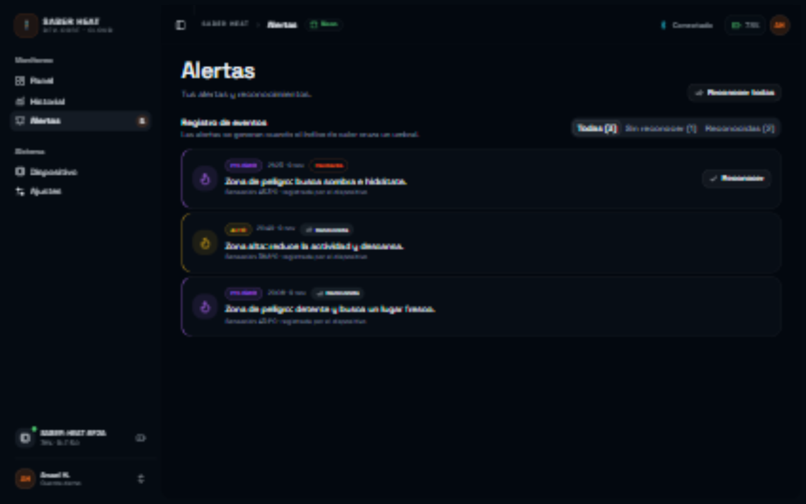

### Ajustes y estado extremo

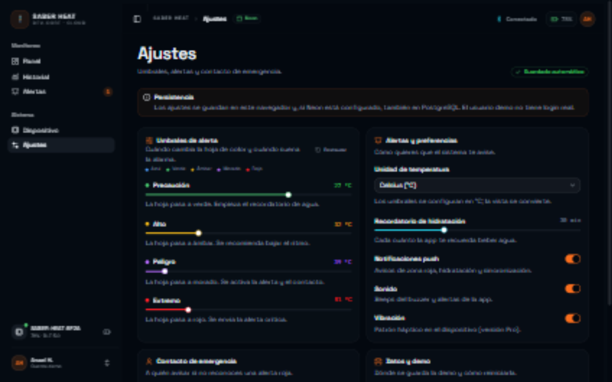

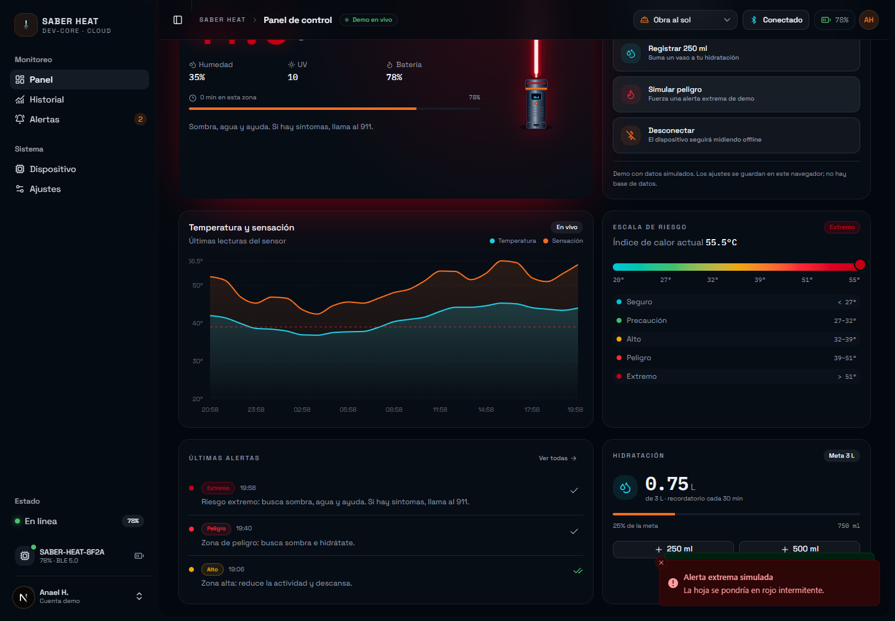

## Estructura del proyecto

```text
src/
  app/
    page.tsx                 # Panel de control
    historial/page.tsx       # Historial de sesión y 7 días
    alertas/page.tsx         # Alertas y reconocimientos
    dispositivo/page.tsx     # Estado, sensores y escenarios
    ajustes/page.tsx         # Umbrales y preferencias
    globals.css              # Tema, tokens y utilidades
    layout.tsx               # Layout raíz con sidebar
  components/
    app-sidebar.tsx
    app-header.tsx
    providers.tsx            # Estado global y simulación
    pairing-dialog.tsx
    blade-visual.tsx
    dashboard/
    alerts/
    ui/                      # Componentes de shadcn/ui
    api/                     # health, session, state, readings, alerts, settings, hydration, device, reset
  lib/
    saber-heat.ts            # Tipos, umbrales, fórmula y datos mock
    db.ts                    # Cliente Neon
    security.ts              # HMAC de sesión + hash scrypt
    session.ts               # Cookie HttpOnly
    neon-repo.ts             # Consultas y persistencia
    api-types.ts             # Contratos de la API
  scripts/
    seed.mjs                 # Esquema + datos demo
    check-db.mjs             # Prueba de conexión
```

## Cómo probar la demo

1. Abre el **Panel** y observa cómo cambian las lecturas cada 3.5 s.
2. Cambia el escenario en el selector del header: **Obra al sol**, **Running**, **Salón** o **Casa**.
3. Pulsa **Simular peligro** para forzar una alerta extrema.
4. Pulsa **Reconocer alerta** o entra a **Alertas** para reconocer eventos.
5. Registra agua con **+250 ml** o **+500 ml**.
6. Ve a **Dispositivo** y prueba **Reemparejar**: el flujo BLE está simulado en tres pasos.
7. En **Historial**, cambia entre **Sesión** y **7 días** y exporta el CSV.
8. En **Ajustes**, mueve los umbrales y cambia la unidad a Fahrenheit.

## Notas y limitaciones

- **La base es opcional.** Sin `DATABASE_URL`, todo vive en el cliente. Con Neon, persiste en PostgreSQL; el usuario demo se crea solo y no hay login multiusuario.
- **No hay Bluetooth real.** El diálogo de emparejamiento simula el flujo; el producto final usaría `Web Bluetooth` en Android y una app nativa o modo Wi-Fi en iOS.
- **Los datos son simulados.** La fórmula del índice de calor es real, pero las lecturas no vienen de un sensor físico.
- **Es un diseño preliminar.** No incluye autenticación real, service worker para offline ni notificaciones push reales.
- **No es un dispositivo médico.** El producto real debe evitar claims de diagnóstico y cumplir la normativa aplicable (NOM-015-STPS, LFPDPPP/LGPDPPSO, COFEPRIS, IFT, PROFECO).
- **Los umbrales** se configuran en °C; la vista convierte a °F.

## Rendimiento y Next.js

La app está pensada para Vercel y para que el shell se pinte de inmediato:

- **Las páginas son estáticas** (`○ Static`): `/`, `/historial`, `/alertas`, `/dispositivo`, `/ajustes`, `/manifest.webmanifest`, `/robots.txt`, `/sitemap.xml`, `/opengraph-image` y `/twitter-image`.
- **Las rutas API son dinámicas** (`ƒ`) y no bloquean el shell: el estado se hidrata desde `/api/state` después del montaje.
- **Cache Components** y **Partial Prefetching** están activos en `next.config.ts`.
- **El shell nunca espera a Neon**: la simulación vive en el cliente y la base se consulta en segundo plano.
- **Fuentes self-hosted** con `next/font` (Space Grotesk + IBM Plex Mono).
- **`optimizePackageImports`** para `lucide-react` y `recharts`.
- **Metadata de producción**: título por ruta, Open Graph, Twitter Card, manifest PWA, iconos 192/512, Apple Touch, `robots.txt` y `sitemap.xml`.
- **`poweredByHeader: false`** para no exponer la tecnología.
- **PWA base**: manifest e iconos listos; falta el service worker para offline (roadmap).

El loop de `instant()` de `next-cache-components-optimizer` no aplica a las páginas: siguen siendo estáticas y el shell se sirve desde el CDN. La hidratación de Neon ocurre después del montaje, así que no hay un `await` request-time que retrase la primera pintura. Si en el futuro mueves la lectura a un Server Component, el patrón es envolverla en `<Suspense>` con un skeleton útil y cachear solo lo reutilizable.

## Roadmap

- [x] Manifest PWA, iconos 192/512, Apple Touch y metadata Open Graph/Twitter.
- [x] Producción: `robots.txt`, `sitemap.xml`, 404 y error boundary global.
- [x] Persistencia en Neon (demo de un usuario) con sesión HMAC y hash scrypt.
- [x] API de estado, lecturas, alertas, ajustes, hidratación, dispositivo y reset.
- [ ] Conectar `Web Bluetooth` real y el servicio GATT del ESP32-C3.
- [ ] Multiusuario y autenticación real (login, CSRF y rate limiting).
- [ ] Service worker para PWA offline.
- [ ] Web Push con VAPID para alertas al contacto de emergencia.
- [ ] Tests E2E con Playwright.
- [ ] Deploy en Vercel.

## Créditos

Diseño, código y datos simulados: Anael. Inspirado en la estética de la ciencia ficción; no usa marcas registradas de Star Wars.

## Licencia

MIT. Consulta [LICENSE](LICENSE).
